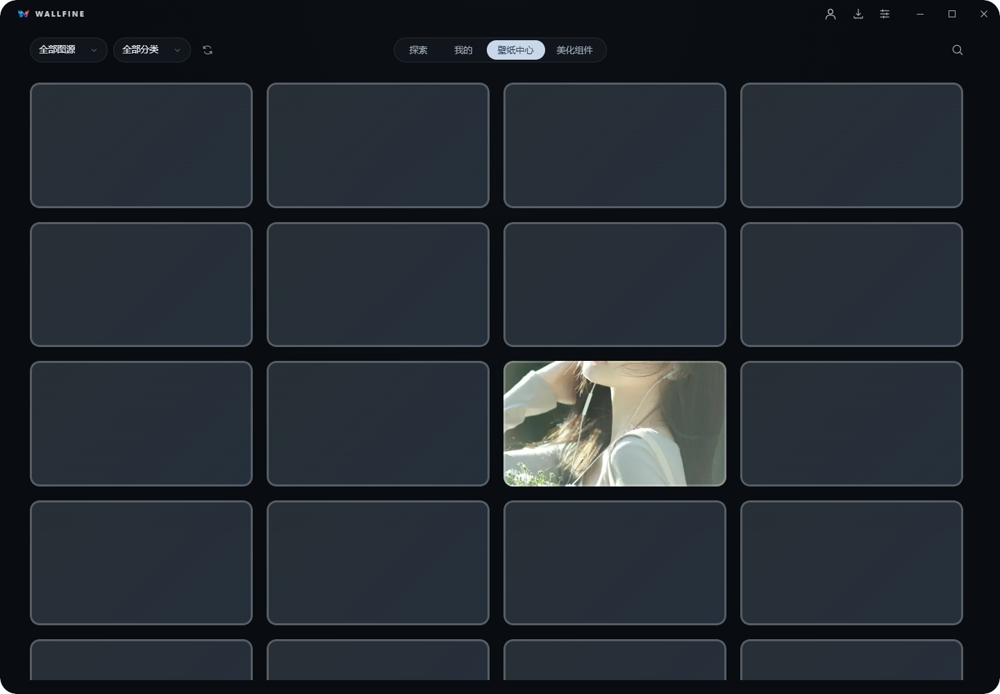
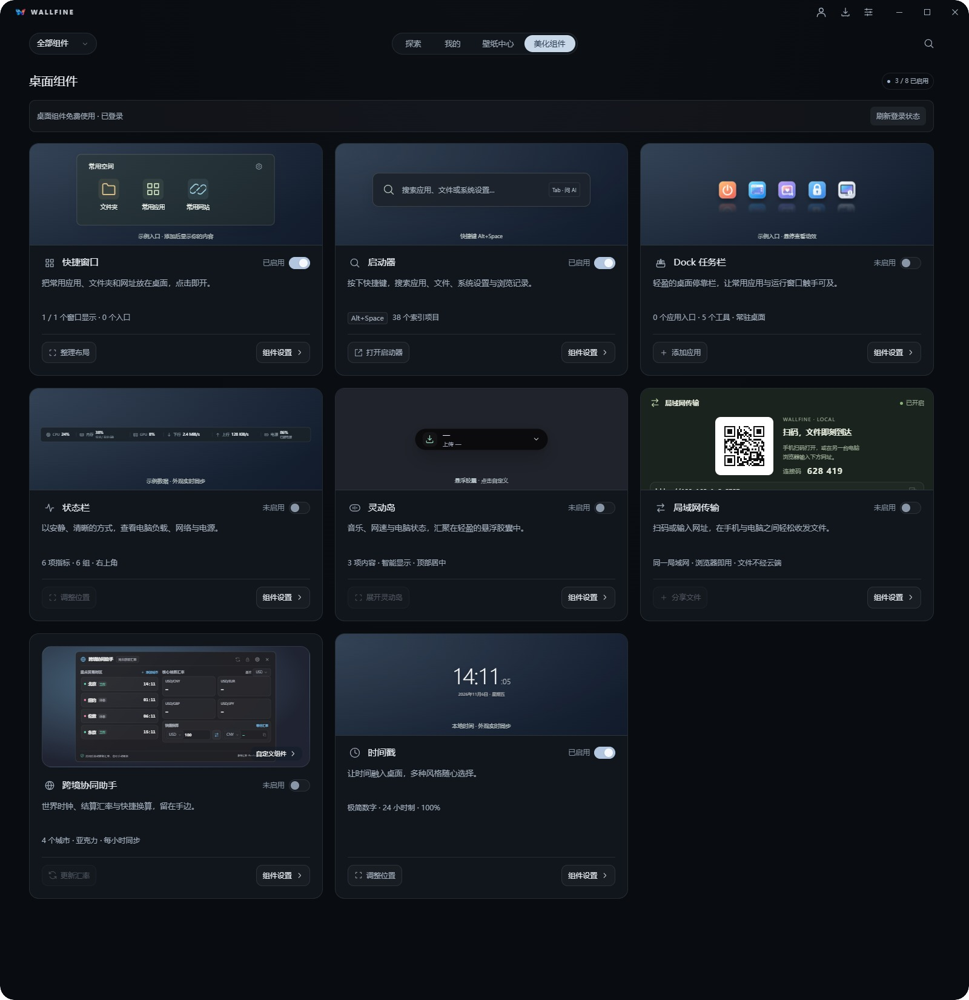
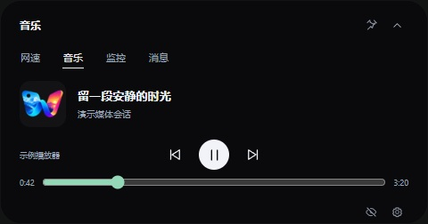
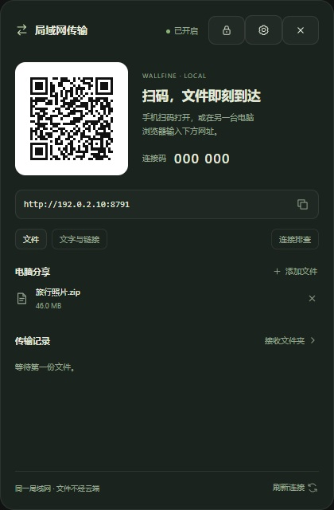

<h1 align="center">Wallfine</h1>

给桌面留一处喜欢的风景。

Windows x64 · 壁纸管理 · 桌面组件 · 闭源应用

<a href="https://github.com/belowsea/wallfine-wallpaper/releases/latest">下载 Windows 版</a> · <a href="https://www.wallfine.cn">官方网站</a> · <a href="docs/installation.md">安装与常见问题</a> · <a href="https://github.com/belowsea/wallfine-wallpaper/issues/new/choose">反馈问题</a>

Wallfine 将壁纸浏览、收藏、本地图库和桌面组件放在一起，让寻找风景和日常桌面操作更顺手。本仓库用于公开展示、发布安装包和收集反馈，**不提供应用源码**。

## 可以做什么

| 功能 | 体验 |
| --- | --- |
| 壁纸中心与探索 | 多图源浏览、分类、搜索与大图预览，支持收藏和下载。 |
| 本地图库 | 管理导入图片与已下载图片；引用原文件，移除登记不会删除原图。 |
| 多屏壁纸与自动更换 | 选择全部屏幕、当前屏幕或指定屏幕；设置周期、分类和最近图片去重。 |
| 桌面组件 | 快捷窗口、启动器、Dock 任务栏、系统状态栏、时间戳、灵动岛、跨境协同助手、局域网传输。 |
| 灵动岛 | 自定义位置、音乐信息与通知提醒；媒体控制、封面和进度取决于播放器提供的能力。 |
| 局域网传输 | 同一可信局域网内收发选定文件、显式分享文字与链接，不自动打开收到的链接。 |
| 可选 AI | 在启动器中配置自己的模型服务，用于文本与图片相关任务；服务费用由对应服务商决定。 |

桌面组件与自动更换功能登录后免费使用。在线资源的可用范围、下载或原图设置额度，以官网当前规则和账户实际权益为准；赞助支持说明见官网。

## 界面预览

### 桌面组件

### 灵动岛与局域网传输

| 音乐界面 | 局域网文件分享 |
| --- | --- |
|  |  |

以上为当前程序界面截图，使用隔离演示数据：账户、媒体、文件、网络地址与连接信息均非真实使用记录。音乐图为界面演示，不代表所有播放器均已适配；局域网示例地址不能用于连接。壁纸素材权利归各自权利人，截图展示不代表素材可任意商用。

## 下载与安装

1. 前往 [Releases](https://github.com/belowsea/wallfine-wallpaper/releases/latest)，下载 `Wallfine-版本-x64-Setup.exe`。
2. 安装前从系统托盘退出正在运行的旧版，运行安装程序。
3. 启动后按需登录、选择壁纸或开启桌面组件。

运行环境为 Windows x64，需 Microsoft Edge WebView2 Runtime。缺少运行时时，安装引导可能需要联网补装。当前主要验证环境为 Windows 11；更多 Windows 版本、多屏和播放器兼容性见 [安装说明](docs/installation.md)。

Release 中的 `.sig` 和校验文件用于更新验证与完整性核对；**Tauri 更新签名不等于 Windows 发行者证书**。GitHub 自动生成的 “Source code” ZIP/TAR 只包含本展示仓库的文档与图片，不是应用源码，也不是安装包。

GitHub 安装包发布与应用内更新是两条发布链路。应用内是否提示新版，以官网版本服务的发布状态为准。

## 帮助与反馈

- [安装与常见问题](docs/installation.md)
- [反馈指南](docs/feedback.md) · [提交问题或建议](https://github.com/belowsea/wallfine-wallpaper/issues/new/choose)
- [更新记录](CHANGELOG.md)
- [隐私说明](docs/privacy.md) · [使用与素材说明](docs/usage.md)
- [第三方组件说明](THIRD_PARTY_NOTICES.md)

反馈截图和日志前，请移除账户资料、设备名称、私人文件路径、连接码、令牌和 API 密钥。安全问题请通过 [官网联系方式](https://www.wallfine.cn) 私下联系，勿在公开 Issue 中提交敏感信息。
